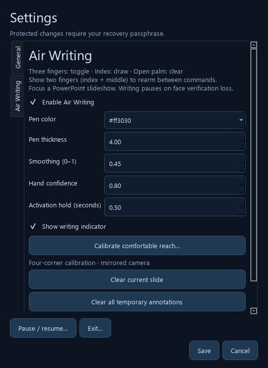
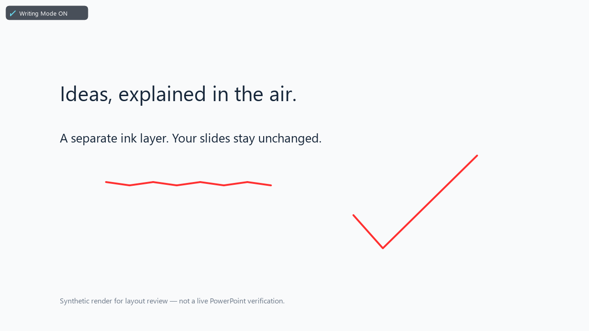

# Air Writing and presentation annotations

Implemented in the existing VisionGuard pipeline on 22 October 2026. **306 automated tests pass, including 70 new writing tests. Real webcam + PowerPoint end-to-end verification has not been performed.** The screenshots below use synthetic content, not a captured presentation.

## Use it

1. Start the source app in simulation mode: `.\.venv\Scripts\python.exe main.py --simulation`.
2. Verify your registered face. Your account needs gesture and PowerPoint permissions.
3. Open **Settings → Air Writing** in the settings sidebar. Enable the feature, choose a color/thickness, and calibrate comfortable reach. Save settings with the administrator recovery passphrase. The main camera screen keeps its existing full-screen layout.
4. Open a PowerPoint desktop presentation and start a slideshow. Focus its slideshow or its PowerPoint presenter window. The overlay identifies the active show, including a single show on another monitor.
5. Show **index + middle fingers**, thumb/ring/little folded, briefly to rearm. When writing is off, an open palm can also rearm the existing navigation controls.
6. Hold **index + middle + ring fingers**, thumb/little folded, for at least 0.5 seconds to toggle writing on. Return to the two-finger neutral pose before the next command.
7. Raise **only the index finger**, with the thumb and other fingers folded, to draw. Lower the finger or leave the calibrated region to lift the pen. Each new index pose needs two confident observations before drawing begins.
8. To clear the current slide's ink, rearm with two fingers, then hold **all five fingers extended** for at least 0.5 seconds. Writing stays on. Holding the palm continuously only clears once.
9. Rearm and repeat the three-finger gesture to switch writing off. Left/right L navigation is available again. Fist and pinch still use the existing exit mappings; they also require neutral rearming.

While writing is on, L gestures never navigate. While writing is off, open palm remains a neutral gesture and cannot clear ink. Annotations remain visible when writing is toggled off, while the authorized user and focused slideshow remain available.

## Calibration and controls

Calibration reuses the application's mirrored camera preview and hand tracker. Click the capture button, then use its three-second delay to point at your comfortable **top-left, top-right, bottom-right, bottom-left** positions. Keep your face visible. There is no second camera capture or second MediaPipe instance. No drawing or Office gesture commands are accepted during calibration.

All four positions must form a sufficiently large convex region. Degenerate, crossed, non-finite and out-of-range calibration is rejected. Calibration remains a draft until protected settings are saved; Cancel leaves the existing mapping unchanged.

The four points define a projective transform from normalized mirrored camera coordinates to normalized slide coordinates. No camera-pixel/screen-pixel 1:1 mapping is used. The renderer fits the presentation aspect ratio inside the slideshow client area, excluding letterbox/pillarbox bands. Normalized strokes keep their relative positions across resizing. Windows placement uses physical pixels, including negative monitor origins, and Qt paints at its current device-pixel ratio.

The page provides enabled state, hexadecimal pen color, thickness (1–20), smoothing (0–1), hand confidence (0.80–0.99), toggle/clear hold time (0.5–2 seconds), calibration, indicator visibility, current-slide clear and all-temporary-ink clear. Greater smoothing reduces jitter with more lag. Hand confidence is an acceptance threshold on classified tracker observations, not a claim of calibrated probability.

GUI clear buttons also require a currently verified, present, permitted user. They can be used while Settings has focus. For current-slide clear with multiple shows, first select the intended slideshow through PowerPoint. Clear-all operates on all temporary sessions, with their identities rechecked when the request is consumed.

## Runtime behavior

- `air_writing.py` owns the gesture arbiter, time-based smoothing, four-point coordinate transform and bounded in-memory stroke store. One command latch governs toggling, clearing, navigation and exit. Losing a hand is not neutral rearming. Multiple hands, ambiguous poses and low confidence stop the stroke and reset the candidate hold.
- `OfficeWorker` reads show identity, `SlideID`, presentation aspect ratio, display state and window geometry on its existing COM STA thread. Its show poll interval is 80 ms plus scheduling/COM time; actual observed latency must be measured on the target laptop. All GUI/vision consumers receive plain data rather than COM objects. Data older than 250 ms or failed reads cannot authorize writing.
- Show sessions use generated local identities and slide identities include the owning presentation fingerprint. A slide change ends the active stroke and requires neutral rearming, preventing a held index from spilling onto the next slide. Revisiting a slide restores its own strokes. A confirmed show closure discards its ink. Transient COM failures hide it without silently deleting it.
- `AnnotationOverlay` paints on the GUI thread, with transparent/click-through/non-activating window flags and Windows `WS_EX_NOACTIVATE`, `WS_EX_TRANSPARENT` and `SWP_NOACTIVATE`. It requests no focus, sends no mouse/key injection and makes no Office edits. Paths append new points without rebuilding completed paths on each frame. There is a 10,000-point-per-slide / 50,000-point-total bound; the user must clear ink to continue once a limit is reached.
- `VisionWorker` uses the existing hand detections and index landmark 8. The camera is already mirrored before tracking; coordinates are not flipped a second time. Capture older than 200 ms is not accepted for ink. The latest frame/sample is used, without a growing queue of fingertip positions.
- Authorization requires a fresh matched face, exactly one visible person, existing liveness/identity checks, global gestures and PowerPoint permissions. Face-quality grace does **not** authorize drawing or clearing. Loss, replacement, permission revocation, camera failure, pause, secure desktop and worker shutdown suspend input. The overlay hides immediately when authorization is unavailable; ink remains in memory until its show closes or an authorized clear.
- Existing owner/trusted-presence timers and Windows locking policy continue independently. Air Writing never resets an absence timer and never unlocks Windows. The Office dispatch and final COM guards also reject queued navigation while writing is on.

No ink is written into slide shapes, text, images or native PowerPoint ink. There is no permanent ink save/export in this initial implementation. The distributed executable must be rebuilt to include these source changes.

## Automated verification

Command: `.\.venv\Scripts\python.exe -m pytest -q --basetemp .tmp\air-writing-full`

Result: **306 passed**. The original 236 tests remain included. The 70 new tests cover exact finger geometry, toggle on/off/hold behavior, confident continuous strokes and pen lift, clear stabilization/scope, suppression and queued-command rejection, legacy navigation, calibration/mirroring/aspect ratio, smoothing, slide/show separation, bounded storage, fresh authorization, grace/camera loss, preservation of the absence lock timer, calibration cancellation and preview reuse, protected settings, transparent rendering, resized rendering, native non-activation flags, COM read-only metadata and overlay removal.

These use synthetic landmarks, mocked Office/session APIs, offscreen Qt rendering and isolated profiles. They do not establish camera accuracy, native foreground behavior or hardware latency. An additional source-entry smoke render opens no camera, sends no Office commands and performs no real locking.

## Real Windows / webcam / PowerPoint checklist

All items below are **NOT PERFORMED**. Record results on the intended Windows laptop with desktop PowerPoint installed. Start in simulation mode and use a disposable presentation with at least three slides containing text, shapes and images.

1. Register/verify an authorized account. Test all finger poses with both anatomical hands in normal lighting. Verify that a partial or wrong three-finger pose does not toggle and that a hold under 500 ms does not trigger. Hold the correct pose for several seconds: only one toggle occurs. Rearm with two fingers and toggle back off.
2. Calibrate four comfortable reach corners while observing the mirrored preview. Save, restart and confirm calibration persists. Check corners and center in a 16:9 show, a 4:3 show and a windowed show. Cancel a second calibration and verify the saved calibration remains intact.
3. Toggle on, rearm, then write slow curves, quick straight lines and dots. Compare smoothing settings and verify tolerable latency/jitter on this laptop. Lower the finger, move outside the calibrated region, hide the hand and change gestures: each ends the stroke without joining unrelated points.
4. Draw on slide 1. Change to slide 2 with PowerPoint's own keyboard/mouse, rearm and draw different ink. Return to slide 1. Confirm both retain only their own strokes, including when slides have the same ordinal in different presentations.
5. Briefly show a palm; no clear. Rearm and hold a full palm for 500 ms; only the current slide's ink clears, once, while writing stays on. Check another slide's ink remains. Verify slide count, text, shapes and images are unchanged and PowerPoint does not acquire document edits from writing/clearing.
6. While writing is on, hold left and right L gestures: no navigation. Toggle off and test previous/next plus first/last boundaries. In either mode, rearm and test fist/pinch exit according to the configured mappings. Existing Word navigation/pause/resume must still work.
7. Click through the overlay, use slideshow keys and inspect focus: PowerPoint must retain keyboard focus; the overlay must never become the foreground window. Check Presenter View with the show on another monitor, negative desktop coordinates, 100%/150%/200% display scaling, monitor migration, resizing, black/white screens and Alt-Tab. Do not accept displaced ink, a background rectangle, blocked clicks or focus theft.
8. With ink present, hide the face, introduce an unknown person, add a second person, revoke the user's PowerPoint permission, disable global gestures, pause monitoring and disconnect the camera. New drawing, toggling and clearing must stop. Existing ink must hide without being assigned to a new person/slide. Reverify and rearm before resuming.
9. Enable auto-lock **simulation**, verify the device owner/trusted presence and then step away. A registered presenter without trusted-presence permission must not prevent the configured simulated lock. If a real Windows lock is separately enabled after simulation checks, unlock normally through Windows and verify that no old gesture resumes automatically.
10. Exit the slideshow, close its presentation, restart the slideshow and stop VisionGuard. Confirm no orphan overlay remains and a newly started show contains no old temporary ink. Try concurrent shows and a temporary busy Office dialog; ambiguous/stale targets must not receive input.

Implementation references: [Qt window flags and widget attributes](https://doc.qt.io/qt-6/qt.html), [SetWindowPos and SWP_NOACTIVATE](https://learn.microsoft.com/en-us/windows/win32/api/winuser/nf-winuser-setwindowpos), [PowerPoint's current displayed slide](https://learn.microsoft.com/en-us/office/vba/api/powerpoint.slideshowview.slide), [slideshow display state](https://learn.microsoft.com/en-us/office/vba/api/powerpoint.slideshowview.state).
